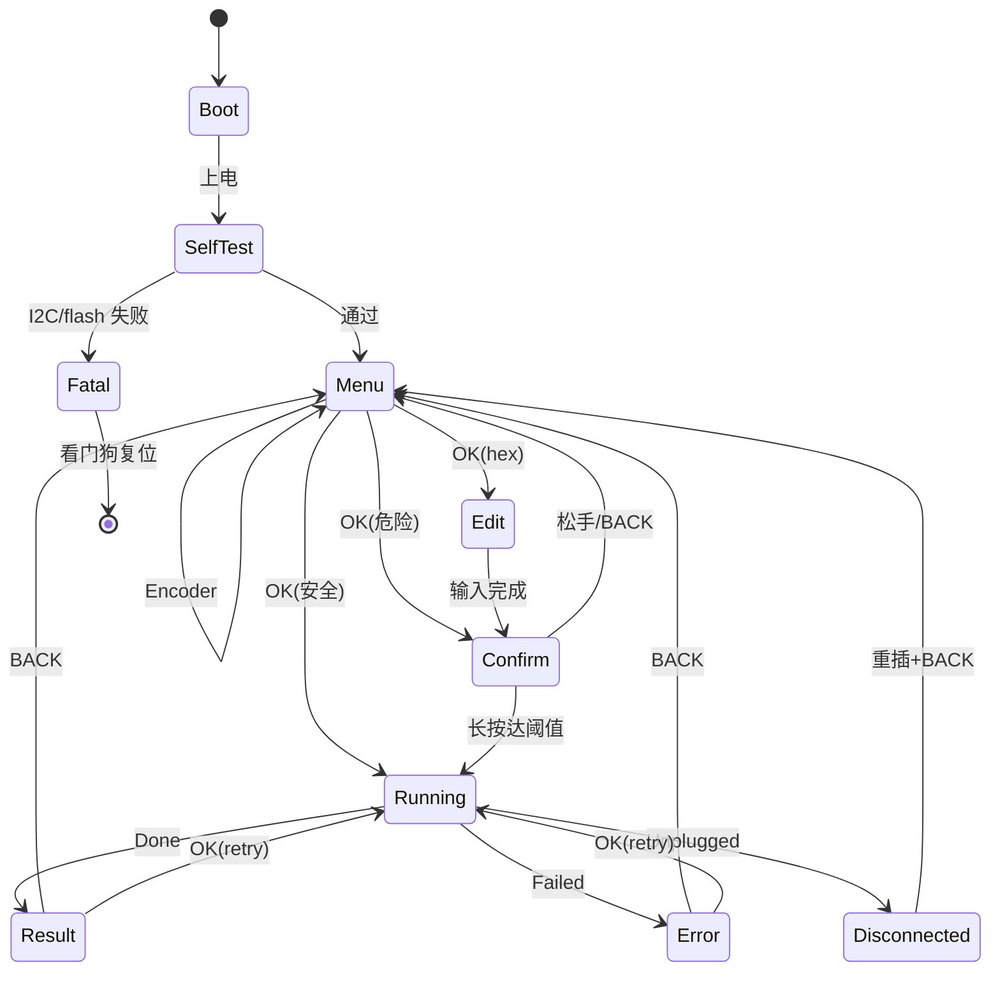

# 09 · OLED + 按键交互设计：128×64 单色屏 + 编码器/按键 + RP2354 自制板
> 作者：teammate **ui-designer**。生成于 2026-11-04（Asia/Shanghai）。存储位置：`rp2354` 分支，**已提交**。
> 基线：main 工作树 `e594539`（auRokku v0.3.1）；配套 07（平台/USB host）、08（core 抽取）、10（no_std spike）。
> 硬件前提（用户已确认）：**完全自制 PCB、直接采购 RP2354A 芯片焊接**，不用 Pico 2 成品板；OLED 用 4 针 I2C 排针或 FPC，按键/编码器上板。
> 标记：**【事实】**=可核对；“**推断**”=由事实推导未实测；“**待验证**”=依赖硬件，见 07。本页只定 UI/面板/BOM 增量；USB host 以 07 为准，协议与 core 以 08/10 为准。

## 0. 结论先行
**推荐配置**：1.3 英寸 128×64 单色 I2C OLED（**SSD1306/SSD1315 兼容控制器**）+ **EC11 旋转编码器（带按压）+ 独立 BACK 键**；embassy + embedded-graphics + `ssd1306` 0.10；**自写约 500 行菜单状态机**（不用 embedded-menu）；英文/ASCII 界面，中文仅作 V1.1 的 5–8 KB 子集字体；写操作一律「长按确认 + 明示不可逆」。

| # | 结论 | 依据 |
|---|---|---|
| 1 | 0.96 与 1.3 英寸 128×64 的核心差异是**控制器**（SSD1306/1315 vs SH1106）和像素间距（≈0.17 vs 0.23 mm），不是分辨率 | 事实 |
| 2 | 1.3 英寸必须在 BOM 锁定控制器；SH1106 仅页寻址、128 宽面板列偏移 2，`ssd1306` 的初始化序列不适用 | 事实 |
| 3 | 400 kHz I2C 全屏 1024 B 理论 ≈23 ms/帧（43 fps），实测 25–35 ms；事件驱动 UI 足够，不做动画 | 计算 |
| 4 | 2 MB flash 放得下完整中文（wqy12 GB2312 实测 202,690 B），但**不值得**；固定文案 12px 子集仅 5–8 KB | 事实 |
| 5 | `sh1106` crate 仍依赖 embedded-hal 0.2，不能直接配 embassy async I2C；用 ssd1306 0.10 或 30 行自写 SH1106 驱动 | 事实 |
| 6 | `embedded-menu` 0.7 可用但下载量小、无进度/危险确认/分页，**建议自写**（桌面模拟器可复用） | 推断 |
| 7 | 推荐 **EC11+BACK** 而非 3 键：长列表/8 位 hex 输入更顺手，误触更少，成本仅多 ≈¥2 | 推断 |
| 8 | 128×64 对“菜单 + 6 行短值”够用；21 B raw hex / 完整错误消息**必须分页** | 事实+推断 |
| 9 | 最大 UX 风险是写/清除 UIM lock、重置 PIN 的误触；必须长按 1.5–2 s + 新旧值同屏 + 不可逆警告 | 推断 |
| 10 | 面板 BOM 增量 ≈¥76（1 片 4 层板）/¥38（10 片）/¥26（100 片）；整机见 07 §4.6；UI 约 10–15 人日 | 推断 |
## 1. 显示选型
### 1.1 控制器差异（第一决定因素）
| 项 | SSD1306 | SSD1315 | SH1106 | SSD1327（128×128 灰度） |
|---|---|---|---|---|
| 显存 | 128×64 = 1024 B | 128×64 = 1024 B | **132×64**（128 宽用列 2–129） | 128×128×4 bit |
| 寻址 | 页/水平/垂直 | 页/水平/垂直 | **仅页** | 页/水平/垂直 |
| I2C / SPI 上限 | 400 kHz / 10 MHz | 400 kHz / 10 MHz | 400 kHz / 2 MHz（4 MHz@VDD1≥2.4 V） | 400 kHz / 10 MHz |
| 7 位地址 | 0x3C/0x3D | 0x3C/0x3D（8 位 0x78/0x7A） | 0x3C/0x3D | 0x3C/0x3D |
| 初始化 | 基准 | **除滚动外与 SSD1306 相同** | 0x20/0x21/0x22/0x8D 序列无效 | 不同（灰度） |
| Rust 驱动 | `ssd1306` 0.10（e-h 1.0，async） | 同左 | `sh1106` 0.5（e-h **0.2**，2023-08 后未更新） | `edrv-ssd1327` 0.1（SPI） |
| 常见尺寸 | 0.96 | 0.96/1.3 | 1.3（Adafruit #938 即 SH1106G SPI） | 1.5 |

**来源**：SSD1306 数据手册 <https://cdn-shop.adafruit.com/datasheets/SSD1306.pdf>；SH1106 规格 <https://github.com/tuhde/Periph/wiki/SH1106>；SSD1315 模块页 <https://wiki.lckfb.com/zh-hans/tspi-rk3566/documentation/gj-ssd1315-oled-module.html>（3.3 V/9 mA、0x78/0x7A）；Adafruit #938 标题标注 SH1106G SPI。
### 1.2 刷新率：400 kHz I2C 够不够
```text
全帧 = 1 地址 + 1 控制(0x40) + 1024 数据 = 1026 B；每字节 9 bit（含 ACK）≈9234 bit
100 kHz → 92.3 ms/帧（10.8 fps）   400 kHz → 23.1 ms/帧（43 fps，理论）
SPI 10 MHz → 1024×8/10e6 ≈ 0.82 ms/帧
```
**结论**：I2C 400 kHz 够用，不必为刷新率上 SPI。SPI 仅在 128×128 彩色 TFT、>30 fps 动画、或 I2C 受干扰时考虑；代价是多 3–4 根线，而 RP2354A 只有 2 个 SPI 控制器。
### 1.3 单色 OLED 可读性
0.96 英寸有效区 ≈21.74×10.86 mm、像素间距 ≈0.17 mm；1.3 英寸 ≈29.42×14.70 mm、≈0.23 mm。6×10 ASCII 分别约 1.7/2.3 mm 高，12×12 中文约 2.0/2.8 mm 高。室内自发光对比极佳；强光下对比度下降，建议雾面盖板。模块电流约 20 mA（Adafruit #326），SSD1315 模块标 9 mA。
### 1.4 128×128 / 彩色 TFT 对比
| 方案 | 代表（Adafruit） | 价 | 信息量 | 帧缓冲 | 代价 | 结论 |
|---|---|---|---|---|---|---|
| 128×64 单色 | 0.96 #326 | $17.50 | 21×6 字符 | 1 KB | I2C 2 线，~20 mA | ★★★★★ MVP |
| 128×64 单色 | 1.3 #938（SH1106G SPI） | $19.95 | 同上、更大 | 1 KB | SPI 5 线 | ★★★★★ 需驱动适配 |
| 128×128 单色 | 1.12 #5297 | $17.50 | 21×12 字符，hex 从容 | 2 KB | 控制器待确认 | ★★★★ |
| 128×128 灰度 | 1.5 #4741 | $22.50 | 同上 + 灰阶 | 8 KB | SPI、体积 | ★★★ |
| 135×240 彩色 | 1.14 ST7789 #4383 | **$9.95** | 40×15 字符，可红色警示 | 64.8 KB（RGB565） | SPI 6 线+背光，30–60 mA，壳体更厚 | ★★★☆ 便宜但复杂 |
| 240×240 圆屏 | 1.28 GC9A01 #6178 | $17.50 | 信息最多 | 115 KB | SPI/功耗 | ★★ 圆屏不适合列表 |

**判断**：彩色 TFT 零售价反而低于 OLED，但引入背光、功耗、线数、强光反射；本工具核心信息是**短标签 + hex**，单色 OLED 更契合。推荐 **1.3 英寸单色**（成本与 0.96 同档、可读性更好）；空间受限再退 0.96。
### 1.5 推荐型号与价格带
| 物料 | 型号/规格 | 采购备注 | 人民币参考（**推断**，2026-11） |
|---|---|---|---|
| 屏 | 1.3 英寸 128×64 I2C，SSD1315/SSD1306，4 针排针/FPC | 下单前确认控制器，避免 SH1106；同批号采购 | ¥12–18 |
| 屏（备选） | 0.96 英寸 128×64 SSD1306 I2C | 最通用、资料最多 | ¥8–12 |
| 旋钮 | EC11 带按压、20 脉冲/圈、带 detent | 优先带螺纹轴 | ¥2–3.5 |
| 轻触键 | 6×6×4.3 mm（BACK/BOOTSEL/RESET） | | ¥0.1–0.3/只 |

美元零售证据：0.96 #326 $17.50；1.3 #938 $19.95；1.12 128×128 #5297 $17.50；1.5 128×128 #4741 $22.50；1.14 ST7789 #4383 $9.95；EC11 #377 $4.50；6 mm 键 20 只 #367 $2.50。立创/淘宝散件显著更低，BOM 用人民币区间。
## 2. 中文显示方案
### 2.1 三种方案
| 方案 | 实现 | flash（实测/估算） | 渲染/维护/许可 |
|---|---|---|---|
| A. 外挂 GB2312/Unicode 点阵 | 按编码索引，16×16 或 12×12 | 16×16：6763×32 B ≈ **216 KB**；12×12：6763×18 B ≈ **122 KB** | 查表 blit 很快；需自制生成工具；字库许可需审查 |
| B. U8g2 字库（`u8g2-fonts` 0.8） | `FontRenderer::new::<fonts::...>()` | wqy12 GB2312 **202,690 B**；wqy16 GB2312 **308,472 B**；wqy12 chinese1 **9,391 B/411 字**；chinese2 **13,526 B/574 字**；boutique 7×7 GB2312 114,214 B | 逐字形位图，仅链接被引用字体；crate 活跃；**字体非 MIT/Apache** |
| C. 仅 ASCII + 图标 | embedded-graphics `mono_font` 5×8/6×10/9×15 + 自绘 8×8 图标 | <3 KB | 最快、零许可风险 |

**渲染速度**：全屏 flush（23 ms）是瓶颈；字体渲染 100 字级 <1 ms（**推断**），不影响帧率。
**事实来源**：U8g2 single_font_files 的数组长度（如 `u8g2_font_wqy12_t_gb2312[202690]`）；`u8g2-fonts` 的 `src/fonts/mod.rs` 字表。
### 2.2 裁剪与预算（RP2354A：2 MB flash）
| 内容 | 字号 | 字数 | flash |
|---|---|---|---|
| 固定 UI 文案（菜单/提示/错误短句） | 12×12 | 150–250 | 4–5 KB（18 B/字 + 表头） |
| 上述 + 全部错误消息/设置页 | 12×12 | 250–350 | 5–7 KB |
| 完整 GB2312 | 12×12 / 16×16 | 6763 | ≈122 KB / ≈216 KB（占 2 MB 的 6%/11%） |

**策略**：MVP 只做英文/ASCII（UIM/PIN/ICCID/SERI 本为英文缩写，hex/数字必须等宽，避免 0/O、1/l 误读）；V1.1 若需要中文，只加固定文案子集 12×12（5–8 KB），不引完整字库。
### 2.3 字体许可（MIT 项目的硬约束）
`auroku` 为 **MIT**。U8g2 字体不在 MIT/Apache 下（`u8g2-fonts` README 明示），wqy 为 GPL 系。若不想 GPL 传染：首选 **Ark Pixel Font**（字体 OFL-1.1、构建工具 MIT、12px 活跃、覆盖泛 CJK），从中生成 1bpp 位图并裁剪子集；备选 Fusion Pixel / Cubic 11（逐个核对 LICENSE）。若坚持 U8g2 字库，把字体作为独立可替换资源并保留许可说明。
## 3. 软件栈
### 3.1 crate 现状（2026-11 抓取）
| crate | 版本 | 更新 | 关键事实 |
|---|---|---|---|
| `embassy-rp` | 0.10.0 | 2026-03 | 官方描述支持 **RP235x**（feature `rp235xa`）；0.9 起 `reset_to_usb_boot` for rp235x；I2C 超时配置（`Config::timeout`，默认 1 s）与 async 总线锁死恢复在**主干未发布**（0.10.0 之后），选版本时需确认 |
| `embassy-executor` / `embassy-time` | 0.10.0 / 0.5.1 | 2026-03 | 单线程 executor 足够 |
| `embedded-hal` / `-async` | 1.0.0 / 1.0.0 | 2024-01 | ssd1306/embassy 均基于 1.0 |
| `embedded-graphics` | 0.8.2 | 2026-02 | 绘图原语 + `mono_font::ascii::FONT_6X10` 等 |
| `ssd1306` | 0.10.0 | 2025-03 | I2C/SPI，feature `graphics`（默认）/`async`；`into_buffered_graphics_mode()` = **1 KB 帧缓冲** |
| `sh1106` | 0.5.0 | 2023-08 | **e-h 0.2.3**，无 async，不能直接接 embassy |
| `u8g2-fonts` | 0.8.0 | 2026-05 | 纯 Rust U8g2 渲染；仅链接用到的字体 |
| `embedded-menu` | 0.7.0 | 2026-08 | 依赖 embedded-layout 0.4 + embedded-text 0.7；近 90 天下载 776；无进度/危险确认/分页 |
| `defmt` / `panic-probe` | 1.2.0 / 1.0.0 | 2025–2026 | 与 embassy-rp `defmt` feature 配套 |

**栈兼容性说明（与 06 主线绑定）**：本页的 embassy + `ssd1306` async 栈对应「embassy-rp + PIO-USB host」路线，或等 embassy 提供 RP2350 原生 HCD 后再切回 embassy。若 06 主线采用 07 的 pure-Rust 原生 host（rp235x-hal 0.4 + RTIC2 + cotton-usb-host git），只需把 HAL/执行器/显示绑定替换为 rp235x-hal 的同步 I2C + `ssd1306` sync：1 KB 帧缓冲、25–35 ms/帧不变，**UI 状态机、菜单树、线框、确认流程、BOM、GPIO 分配全部不变**。若最终走 C/C++ TinyUSB 兜底，UI 用 u8g2 实现同一套界面，上述设计规格同样不变。

### 3.2 自写还是 `embedded-menu`
| 维度 | embedded-menu 0.7 | 自写状态机 |
|---|---|---|
| 菜单树/多选 | 现成（宏） | 约 200 行 |
| 进度/超时/危险确认/hex 输入/长文本分页 | **都没有** | 约 320 行 |
| 与 async USB 解耦、桌面模拟器复用 | 需改造；依赖 SDL2 | 纯逻辑，host 100% 复用 |
| 维护 | 单作者、低下载量 | 自担，但代码量小 |

**建议**：自写 `auroku-ui`（no_std 库，不依赖 embassy/USB）；输入 = 编码器/按键事件 + 任务事件，输出 = 屏幕行/反显区间/进度值；OLED 渲染器与桌面 egui 预览共用同一视图模型。约 400–600 行 + golden 测试。
### 3.3 RAM / Flash 预算（520 KB SRAM / 2 MB flash）
| 项 | 占用 | 说明 |
|---|---|---|
| OLED 帧缓冲 | 1,024 B | 单缓冲 |
| UI 状态/字符串 | 2–4 KB | `heapless::String<96>`，无堆 |
| 命令/事件通道 | 1–2 KB | `Channel<Command,2>` + `Channel<Event,8>` |
| embassy 任务栈 | 3 × 2–4 KB | ui/usb/log |
| USB host 栈与缓冲 | 8–20 KB | **待验证**，以 07 为准 |
| core + 强类型 report | 20–60 KB flash（链接后） | 10 的 rlib 189.5 KB 未裁剪，链接会丢弃未用代码 |
| 字体（ASCII+图标 / 可选中文子集） | <3 KB / 5–8 KB | |
| 合计 | RAM <100 KB、flash <600 KB | 余量充足 |
### 3.4 结果数据接口、defmt 与 panic
- 10 已把 core 的 JSON 改为**强类型 struct**；UI **不解析 JSON**，直接消费 `StatusReport`/`UimLockReport`/`ErrorReport`，键名与现有 GUI 一致，便于桌面回归。
- 错误统一为 `AuRokkuError { kind: ValueError|RuntimeError|TimeoutError|DriverError, message }`（`src/lib.rs:42-64`，**事实**）；UI 只做 kind + 截断 message 映射。长 hex 用 `heapless::String<160>`，禁止 `unwrap`。
- 日志：开发用 `defmt`+RTT（SWD），现场用 UART 或 flash 环形日志；panic 关闭中断→**阻塞 I2C** 画 STOP 帧→LED 闪→看门狗 5 s 复位；运行期 WDT 8 s，由 ui_task 每 1 s 喂狗。
## 4. 按键/编码器与面板
### 4.1 四种输入方案
| 方案 | GPIO | 成本 | 列表 | hex 输入 | 误触 | 评价 |
|---|---|---|---|---|---|---|
| 3 键（上/下/确认） | 3 | ¥0.3 | 慢 | 差（无独立取消） | 高 | **不推荐** |
| 4 键（+取消） | 4 | ¥0.4 | 慢 | 中 | 中 | 可用，最省 |
| 5 向摇杆 | 5 或 1 ADC | ¥1.5–3 | 中 | 中 | 中 | 易漂移/进灰 |
| **EC11 + BACK** | **4**（A/B/SW/BACK） | ¥2.5–4 | **快** | **好** | **低** | **推荐** |
### 4.2 按键映射（编码器版；4 键降级见括号）
| 输入 | 菜单/列表 | 结果页 | hex 输入 | 确认页 |
|---|---|---|---|---|
| 顺时针 / 逆时针 | 下移/上移（快转 2–4 项/格） | 下/上滚 1 行或翻页 | 当前位 +1/−1（0–F 循环；4 键：上下改值） | — |
| 按压短 | 进入/执行 | 翻下一页 | 下一位（末位提交；4 键：OK=下一位） | 开始长按计时 |
| 按压长 1.5–2 s | — | — | — | **确认危险操作**（4 键同） |
| BACK | 返回上一级 | 退出结果 | 上一位（首位取消） | 取消 |
| BACK 长按 1 s | 回主菜单 | 回主菜单 | 取消 | 取消 |
| 上电按住按压 | — | — | — | 进入安全模式（不自动重试/只读） |
### 4.3 去抖、长按与连发
| 项 | 方案 | 参数 |
|---|---|---|
| 机械按键 | RC + 软件确认 | 10 kΩ 上拉 + 100 nF（τ≈1 ms）；20 ms 稳定窗口，按下/释放都确认 |
| 编码器 A/B | 上拉 + 每相 100 nF + 4 状态正交解码 | 1 ms 采样；两次合法跳变才算一格；反向立即生效 |
| 长按 | 按下计时，达到阈值发一次 LongPress | 危险确认 1.5–2.0 s；BACK 回主菜单 1.0 s |
| 防误触 | 危险操作**没有单键路径**；确认页默认焦点在 BACK；按键帽高出面板 1.5–2 mm | — |
### 4.4 面板布局（示意）
```text
+--------------------------------------------------+  外壳 100×62 mm（示意）
|  [OLED 1.3in 128x64]            (o) 蜂鸣器       |
|  +------------------------+      [LED PWR][LED]  |
|  | auRokku  USB*   BAT78% |                       |
|  | >Status                |      +-----------+    |
|  |  UIM Lock              |      |  EC11     |    |
|  |  PIN / ICCID           |      |  旋钮 15mm |    |
|  +------------------------+      +-----------+    |
|                                     [BACK]         |
|  [USB-A host 接手机]  [USB-C 5V 输入]  [SWD/UART]  |
+--------------------------------------------------+
  背面：BOOTSEL / RESET 小孔 Ø1.5 mm、电池仓
```
- 屏窗口：有效区 29.42×14.70 mm，开窗 30.5×16.0 mm，内侧 0.5 mm 黑色泡棉遮光；盖板 1 mm 雾面亚克力/PC。
- 编码器在右手拇指区，BACK 在其左下 15 mm；蜂鸣器 Ø2 mm 孔；LED 导光柱或 1 mm 孔。
- 丝印「ROTATE」「PUSH = OK」「BACK」；危险操作旁不印快捷提示（避免鼓励误操作）。外壳开孔公差 +0.2 mm。
### 4.5 自制板电气要点（UI 部分）
| 项 | 设计 | 理由 |
|---|---|---|
| I2C | I2C0 用 GPIO4/5（远离 USB/QSPI），SDA/SCL 各 4.7 kΩ 上拉 3.3 V；模块自带 10 kΩ 时板上标 DNP | 400 kHz 上升沿；总线电容 <400 pF（NXP UM10204） |
| 屏接口/电源 | 4 针 2.54 排针 + 可选 1.0 mm 4P FPC 焊盘；VCC 经 100 nF+4.7 µF 去耦，串 0 Ω 测电流 | 电荷泵对纹波敏感 |
| 按键/编码器 ESD | 每线 1 kΩ 串阻 + 100 nF 到地；可触摸金属轴经 1 MΩ//4.7 nF 接 GND | 人体 ±8 kV 接触放电保护 |
| USB | host 用 USB-A 母座（无 CC 电阻）；D+/D− 90 Ω 差分、27 Ω 串阻靠芯片、USBLC6 靠座子；VBUS 经限流开关+分压检测。按 07 建议用 **4 层板**（信号-地-电源-信号） | USB host 是 FS 12 Mb/s；4 层板优于官方 2 层；host 口**不能有 1.5 k 上拉** |
| SWD/UART | 6 针 1.27 mm：3V3/SWDIO/SWCLK/GND/UART_TX/UART_RX；另留 RUN、BOOTSEL 测试点 | 不焊排针也能探针 |
| BOOTSEL/RESET | 1 kΩ 从 QSPI_SS 到 BOOTSEL 键到 GND；RESET 拉 RUN 到 GND | 启动时 QSPI_SS 低 = USB MSC（UF2） |
| 供电/地 | 3.3 V LDO ≥300 mA；USB/QSPI 下方完整地；I2C <10 cm、不与 USB 差分长距离并行 | 降 EMI/串扰 |
## 5. 交互设计（重点）
### 5.1 菜单树（与 `Task` 枚举一一对应）
```text
MAIN
+-- 1 Status ................ Task::Status（SN/PIN/UIM/ICCID 综合）
+-- 2 UIM Lock
|   +-- Read ................ Task::ReadUimlk
|   +-- Write ............... Task::Writelk{value,control}（危险）
|   +-- Clear ............... Task::Clearlk（危险）
+-- 3 PIN / ICCID
|   +-- Read PIN ............ Task::Readpin
|   +-- Reset PIN ........... Task::Resetpin（危险）
|   +-- Read ICCID .......... Task::ReadIccid
+-- 4 Maintenance
|   +-- Set bit=1/0 ......... Task::MaintenanceBit{control}（危险）
+-- 5 Probe
|   +-- Layout / SERI echo / SCDP ... Task::Probe{kind}
+-- 6 Batch
|   +-- basic / uimlk ....... Task::Batch{profile}
+-- 7 Session
|   +-- Exit base (0xD8) .... Task::Exit
|   +-- Exit UIMLK (0x56) ... Task::Exituimlk（危险：手机可能重启）
+-- 8 Type2Auth（自检屏，非独立 Task）
|   +-- Auth base / UIMLK / 4000：依次显示 0x52 挑战、派生密钥、0x53 结果
+-- 9 Device info ........... VID/PID/SN/EP/固件/电量/运行时间
+-- 0 Settings .............. 语言/对比度/蜂鸣/日志/安全模式
```
Type2Auth 52/53 在库中是会话内部步骤（`authenticate_step`），不是独立操作；此屏用于现场排障。所有操作默认每次独立开会话（与 `read_*` 内部 enter/finish 一致）。
### 5.2 逐屏线框（6×8 字体：21 列 × 8 行，含顶/底栏）
```text
[B] 主菜单                         [C] 运行中（写操作）
+---------------------+          +---------------------+
| auRokku   USB* 78% |          | RUNNING  writelk    |
|---------------------|          |---------------------|
|>Status              |          | ENTER UIMLK   [OK]  |
| UIM Lock            |          | AUTH 52/53    [OK]  |
| PIN / ICCID         |          | WRITE 0x72   [....] |
| Maintenance         |          | VERIFY 0x54  [    ] |
|     2/10   |        |          | 1.8s / 3.0s timeout |
| OK=enter BACK=up    |          | DO NOT UNPLUG       |
+---------------------+          +---------------------+

[A] 危险确认（写 UIM lock）        [D] hex 输入
+---------------------+          +---------------------+
|! MODIFY UIM BINDING!|          | WRITE UIM LOCK      |
|---------------------|          |---------------------|
| WRITE 80E4 8ED2     |          | VALUE               |
| CTL 1               |          | 80E4_8ED[2]  ctl=1  |
| OLD ffffffff (open) |          |                     |
| WRONG VALUE BINDS   |          | ROT=digit OK=next   |
| SIM. NOT UNDOABLE.  |          | BACK=prev/cancel    |
| HOLD OK 1.5s  BACK  |          |                     |
+---------------------+          +---------------------+

[E] 错误页（长 hex/ICCID 见 §5.4：分页）
+---------------------+
| ERROR  TimeoutError |
|---------------------|
| USB transfer timed  |
| out after 3.0s      |
|                     |
| Check cable / port  |
| OK=retry  BACK=up   |
+---------------------+
```
SELFTEST/STATUS 结果/批量列表/Disconnected/Settings/Fatal 屏结构同模板（标题栏 + 内容区 + 底栏）。
### 5.3 危险操作与确认文案
| 操作 | `Task` | 风险 | 确认 | 同屏必须显示 |
|---|---|---|---|---|
| 写 UIM lock | Writelk | 绑定到错误值；可能无法恢复 | 长按 OK 1.5 s | 新值、控制位、旧值、**NOT UNDOABLE** |
| 清 UIM lock | Clearlk | 锁值变 ffffffff，解除绑定，可能影响服务 | 长按 OK 2.0 s | 旧值、新值、绑定被移除 |
| 重置 PIN | Resetpin | PIN 变 1234，原 PIN 丢失 | 长按 OK 2.0 s | 「PIN -> 1234」、原 PIN 不再可用 |
| 维护位 | MaintenanceBit | 手机进维护模式，需重启 | 长按 OK 1.5 s | control 0/1 + 行为说明 |
| 退出 UIMLK | Exituimlk | 手机可能重启 | 长按 OK 1.0 s | phone may reboot |

规则：危险项默认焦点在 BACK；长按有进度环；松手过早=取消并蜂鸣；**任何单次按键都不能触发写/清/重置**；确认后固定位置显示 IRREVERSIBLE 直到结束。
### 5.4 结果页显示规则
| 数据 | 规则 | 例 |
|---|---|---|
| 8 hex 锁值 | 大写、每 2 字节空格；新旧同屏对照 | `80E4 8ED2` |
| 21 B raw hex（42 hex 字符） | 每行 7 字节（21 字符），最多 3 行/页；页脚 n/m | `59 98 81 10 12 ...` |
| ICCID 解码（20 位） | 4 位分组，避免截断 | `8981 1012 3456 7890 1234` |
| PIN/控制位/布尔 | 4 位数字；0/1 + 语义；校验用 OK/NG | `1234` / `CTL 1 (locked)` / `VERIFY NG` |
| 超长错误 | 首页 kind + 3 行摘要；完整消息最多 3 页 + UART/flash | `TimeoutError: USB transfer...` |
| 批量 | 每条一行 `[OK] state 80E48ED2`，进入看详情 | `basic 2/2` |
### 5.5 错误页映射
| kind（**事实**，lib.rs） | 标题 | 蜂鸣 | 建议 | 重试 |
|---|---|---|---|---|
| `ValueError` | INVALID INPUT | 1 短 | 8 hex 位 / control 0–1 | 否（回编辑） |
| `RuntimeError` | DEVICE ERROR | 3 短 | 设备拒绝命令；检查 SIM/服务模式 | 是 |
| `TimeoutError` | TIMEOUT | 3 短 | 3.0 s 无应答；检查线缆/端口 | 是 |
| `DriverError` | DRIVER/USB | 3 长 | USB host 错误（枚举/供电） | 是 |
| UI 级 `NO_DEVICE` / `DISCONNECTED` | NO DEVICE / UNPLUGGED | 3 短/3 长 | 未找到手机 / 操作中拔线（先读回） | 是 |
| UI 级 `VBUS_CONFLICT` | POWER | 2 长 | 检测到 PC VBUS，切 host 模式 | 否 |

UI 级错误由 USB host 层产生，必须与协议错误用不同标题/图标区分。
### 5.6 进度、超时与非阻塞
- **事实**：单次传输 `DEFAULT_TIMEOUT = 3 s`（lib.rs:27），但 08 §2.2 估算 `status` 最坏 ≈35 s、`resetpin` ≈18 s、`writelk` ≈26 s；因此进度必须按阶段显示。
- 阶段：`DRAIN → ENTER BASE → AUTH 52/53 → READ/WRITE → VERIFY → EXIT`；同时显示本阶段用时与「last transfer 3.0 s timeout」。
- 单操作 >45 s 判 `STUCK`，允许 BACK 取消等待；**写命令一旦发出（0x72/0x57/0xDC 0x01）禁止取消**，显示 DO NOT UNPLUG；拔线则结果页红色 `partial_write_possible` 警告。
- UI 10 Hz tick；I2C flush 23 ms 异步等待期间 executor 可跑其他任务，输入不丢。
### 5.7 会话/退出
| 触发 | 行为 |
|---|---|
| 任一操作 | 库内部自开会话并退出；UI 回结果页 |
| 空闲 60 s | 自动 `Exit`（0xD8），手机恢复正常界面 |
| BACK 于主菜单 | Session 页：Exit / Exit UIMLK / 关机 |
| 拔线 | `UNPLUGGED`；写操作中→红色 VERIFY REQUIRED + 日志；重连后建议先 Status |
| 电量<10% | 禁止写，仅读/退出 |
| 关机 | 先 Exit → 关屏 → 关 VBUS 负载开关（有电池则再关 boost）→ 切电源 |
## 6. 状态机架构
### 6.1 任务划分（embassy 单线程 executor）
```text
+------------+  Command (Channel<_,2>)  +-----------+
|  ui_task   | -----------------------> | usb_task  |
| 显示+输入  | <----------------------- | core+host |
+-----+------+  Event (Channel<_,8>)   +-----+-----+
      | 独占屏/按键/UI 状态                  | 独占 USB 控制器/端点
      +--> log_task（UART/flash）<-----------+
```
- `ui_task`：1 ms 轮询编码器 + 20 ms 去抖按键 → 状态机 → 渲染 → flush；**不直接调协议**。
- `usb_task`：收 Command → 调 core（08 的 `UsbTransport`）→ 以 Event 回报阶段/完成/错误；**不碰显示屏**。
- 只读共享状态用 `Mutex<CriticalSectionRawMutex, Shared>`；不共享 Display（单一所有者）。不用 RTIC：embassy Channel/Signal/Mutex 已足够且与 async I2C/USB 一致。
### 6.2 UI 状态机

| 状态 | 渲染 | 允许事件 |
|---|---|---|
| Boot/SelfTest | Logo、I2C/flash/USB 自检 | Tick、按键跳过 |
| Menu{page} | 4 项 + 滚动条 + 状态栏 | Encoder、OK、BACK(long) |
| Edit{field,cursor} | 当前值 + 光标 + 提示 | Encoder、OK、BACK |
| Confirm{action,hold} | 警告 + 新旧值 + 长按进度环 | OK(hold)、BACK |
| Running{stage,elapsed} | 阶段表 + 进度条 + 不可拔线 | Tick、BACK(仅等待)、Done/Failed |
| Result{report,page} | 字段/hex 分页 | Encoder、OK、BACK |
| Error{kind,msg,page} | kind + 截断消息 + 建议 | OK(retry)、BACK |
| Disconnected | 拔线提示 + 验证建议 | BACK、Connected |
### 6.3 写 UIM lock 时序
```text
ui_task                            usb_task
长按 OK -> Running
  Command::Write{value,ctl} -----> 0x72 写 ...
  Tick 100ms：进度环/用时               | Stage(Verify 0x54) -->
  <-------------------------------------+
  渲染阶段表                            Done(report{verified})
  <-------------------------------------+
  BACK -> Menu（库内部已发 0x56/0xD8）
```
### 6.4 错误/超时/拔线恢复
| 情况 | 恢复 |
|---|---|
| TimeoutError | 关闭句柄/释放接口 → 重枚举（最多 1 次）→ 仍失败 Error 页；不清除“可能已部分生效”警告 |
| Runtime/Value | 不重试；Runtime→Error，Value→Edit |
| 写操作中拔线 | 记录 `partial_write_possible`，红色结果页，重连后**先 Status 读回** |
| USB host 枚举失败 | 提示检查 OTG/VBUS；复位 USB 控制器（host 侧能力**待验证**，见 07） |
| I2C 显示锁死 | 用 embassy-rp 的 I2C 超时（主干已加，0.10.0 需自行包一层超时/重试）恢复；连续 3 次 → DISPLAY FAIL，仍可 UART/SWD 排障 |
| 看门狗 | 8 s 未喂狗复位；上电检查异常复位标志 → 进 SelfTest 并提示 |

**掉电/电池保护**：写前查电量 >20%，<10% 禁止写；检测到 VBUS 输入（充电器/PC）时禁止 host 写（细节见 07）；掉电后 flash 只保留“最近结果/错误码/是否写操作中”，上电若发现写标记则显示 VERIFY REQUIRED。
## 7. 可用性细节（自制板）
### 7.1 蜂鸣器/LED/振动
蜂鸣器：无源压电 9×5.5，PWM 2.7 kHz/50%，OK 1×60 ms、错误 3×120 ms、确认 2×40 ms，可静音（¥0.5–0.8）。LED：2×0805 或 1×WS2812B，绿=空闲/橙闪=忙/红=错误（¥0.1–0.5）。振动马达 v1 不做（60–100 mA、结构复杂）。
### 7.2 无文件系统的结果保存
方案：内部 flash 环形日志（1–2 扇区，16–32 条×256 B，10 万次/扇区分摊足够）★★★★★；外部 SPI flash 可选；microSD 留 v2。

记录：开机秒/序号、操作名、kind、锁值/控制位/校验、是否部分写入；Settings 可回看最近 8 条。
### 7.3 电池、充电、续航
3.7 V LiPo 1000–2000 mAh + TP4056/BQ24075 充电 + 3.3 V LDO（≥300 mA）。给手机 5 V：无电池时 USB-C 5 V 经限流开关直供（07 §4.3.3，500 mA SDP）；有电池时用 boost（TPS61023 等，100–500 mA）。本机 UI 约 55 mA（屏 20 + MCU 25 + 其他 10）→ 1000 mAh ≈18 h；同时给手机供电只剩 2–5 h（**推断**，需实测）。
### 7.4 烧屏、防误触、固件升级
- **烧屏**：固定顶/底栏与反显条长期静止会残影（OLED 寿命与亮度强相关，参考 <https://en.wikipedia.org/wiki/OLED_burn-in>）；措施：对比度 0x8F、空闲 60 s 息屏、每 10 min 全屏偏移 ±1 px、反显条随选择移动。
- **防误触**：危险项默认 BACK、长按确认、上电按住编码器进安全模式（不自动重试/只读）、连续 3 次输入取消回主菜单。
- **固件升级**：RP2350 只有**一个 USB 控制器**，host 模式占用后不能同时当 device（07 §4.4）。v1 按 07 架构 A：**USB-A host 接手机 + SWD/UART 烧录**（`probe-rs`）；BOOTSEL+RESET 保留为应急/探针（A 座当 device 需 A-to-A 线，不规范，不建议）。要「插电脑拖 UF2」需 device 口或 mux（07 架构 B/C）。SWD 救砖 + UART 115200 启动日志。
## 8. 原型路径与分阶段交付
### 8.1 先桌面、后硬件
1. **P0 桌面模拟器**：未跟踪工具 `tools/ui-sim`（egui）把 `auroku-ui` 编到 host；↑/↓=编码器、Enter=按压、Esc=BACK、长按 Enter=危险确认，4× 放大画 128×64；先定稿菜单/文案/危险流程/分页并做 golden test。
2. **P1 面包板**：Pico 2 + 1.3 英寸模块 + EC11，验证初始化/帧率/去抖/字体。
3. **P2 自制板 rev A**：按 §4.4/4.5 打样，先焊 MCU/电源/屏/输入；P3/P4 接 07 的 USB host，先读后写联调。
### 8.2 分阶段 UI 交付
| 阶段 | 范围 | 退出标准 | 估算 |
|---|---|---|---|
| P0 模拟器+状态机 | 菜单树、确认、进度、错误、分页、settings；全 Task 假数据 | golden test 通过；危险操作不可能单键触发 | 4–6 人日 |
| P1 屏+输入 | ssd1306、编码器、蜂鸣器、帧率/延迟测量 | 全屏 25–35 ms；输入延迟 <50 ms | 2–3 人日 |
| P2 MVP（只读） | Status/Read UIM/ICCID/Probe/Exit/错误页 | 真机连续 100 次读不失败；拔线可恢复 | 5–8 人日 |
| P3 写操作 | Write/Clear/Reset PIN/Maintenance/Batch/Type2Auth 自检 | 回读校验 UI 与库字段一致；误操作演练 0 次触发 | 4–6 人日 |
| P4 面板/外壳 | 丝印、开孔、ESD、续航、烧屏、UF2 | 过本节末尾的 bring-up 验收 | 3–5 人日（不含打样） |

**硬件 bring-up 验收**：I2C 0x3C/0x3D 应答；全屏 25–35 ms；编码器每格 1 项不跳格；±8 kV ESD 不死机；72 h 固定画面无明显残影；BOOTSEL 拖 UF2 可升级；10 分钟乱按不触发任何写操作。
## 9. 结论：BOM、信息密度与风险
### 9.1 面板 BOM（人民币，含 PCB，不含 RP2354/电源/外壳；**推断**）
| 物料 | 数量 | 1 片 | 10 片 | 100 片 |
|---|---|---|---|---|
| 1.3 英寸 128×64 I2C OLED（SSD1306/1315） | 1 | 15.0 | 12.0 | 9.5 |
| EC11 编码器（带按压/detent） | 1 | 3.5 | 2.8 | 2.2 |
| 6×6 轻触键（BACK/BOOTSEL/RESET） | 3 | 0.9 | 0.6 | 0.45 |
| 无源蜂鸣器 | 1 | 0.8 | 0.6 | 0.45 |
| LED+电阻 | 2 | 0.2 | 0.15 | 0.1 |
| 3.3 V LDO | 1 | 0.6 | 0.45 | 0.35 |
| 阻容（上拉/去抖/去耦） | ~20 | 0.8 | 0.5 | 0.35 |
| ESD/TVS（USB+按键） | 2 | 1.2 | 0.9 | 0.7 |
| USB-A host 座 + USB-C 输入座 | 1 套 | 1.8 | 1.5 | 1.2 |
| 电池座/电源开关/SWD 排针 | 1 套 | 1.6 | 1.25 | 0.95 |
| PCB 4 层 60×100 mm ENIG（07 建议） | 1 | 50.0 | 18.0 | 10.0 |
| **小计** | | **76.4** | **38.8** | **26.2** |

整机另加：RP2354A（含 12 MHz 晶振/内部 1.1 V/去耦）、LiPo+充电+5 V 限流开关、外壳/亚克力窗、装配。按 **07 §4.6** 口径（含首单 SMT 工程费、不含外壳/电池）：约 **$25–40/片、$13–18/10 片、$7–11/100 片**，折合约 **¥180–290 / ¥95–130 / ¥50–80**；本文面板增量为其中一部分，二者相加时勿重复计 PCB/OLED。
### 9.2 信息密度与最大 UX 风险
- 菜单 + 6 行短值：**够**（21×6）；21 B raw hex（42 hex 字符）需 3 行 + 标题，**必须分页**；完整错误只显示 kind + 摘要 + 建议，全文走 UART/flash。**128×64 可用，但要求严格信息分级**，这比换屏更提升体验。

| # | 风险 | 影响 | 缓解 |
|---|---|---|---|
| 1 | 写/清/重置在低成本输入下误触 | 可能改坏 SIM 绑定/PIN | 编码器+BACK、长按确认、危险项默认 BACK、无单键路径 |
| 2 | 20–35 s 长操作被当卡死拔线 | `partial_write_possible` | 阶段进度+DO NOT UNPLUG+45 s 看门狗+拔线后先读回 |
| 3 | 1.3 英寸模块实为 SH1106 | 花屏/偏移 2 列 | BOM 锁控制器；固件内置两套 init（设置可选）；首批全检 |
| 4 | USB host 不可用/供电冲突 | 工具不成立 | 先做 07 的 1–2 周硬件验证，再投入 UI |
| 5 | 烧屏 / 中文字体许可 / 编码器抖动 | 观感/合规/选错项 | 息屏+偏移+0x8F；OFL 字体子集；硬件 RC+4 状态解码 |
| 6 | 单 USB 口升级/供电冲突 | 变砖 | BOOTSEL 小孔+SWD 救砖+07 端口方案 |
### 9.3 未决问题
1. **07 已确认 USB host 可行**；待验证：TinyUSB HCD 在 RP2350 的 2 个已知 host bug（07 §2.3）、手机在 SDP 下的枚举行为、VBUS 限流开关选型（影响 POWER 页与升级流程）。
2. 手机是否必须由主机提供 5 V VBUS（影响续航与电源提示）。
3. SN 来源：设备是否稳定提供 iSerialNumber；无 SN 时 UI 需手输 11 位/16 位 hex 的屏幕（08 指出 UIMLK 认证必须 SN）。
4. 是否要中文界面（决定 V1.1 是否加 5–8 KB 子集字体）。
5. 外壳尺寸/电池/日志介质；07 整机 BOM 与本文面板 BOM 合并后的目标成本。
## 附录 · 外部来源（2026-11-04 抓取）
| 用途 | 链接 |
|---|---|
| SSD1306 手册 / SH1106 规格 / SSD1315 模块 | <https://cdn-shop.adafruit.com/datasheets/SSD1306.pdf> · <https://github.com/tuhde/Periph/wiki/SH1106> · <https://wiki.lckfb.com/zh-hans/tspi-rk3566/documentation/gj-ssd1315-oled-module.html> |
| I2C 规范 UM10204 | <https://www.nxp.com/docs/en/user-guide/UM10204.pdf> |
| RP2350 规格（520 KB SRAM、RP2354A 2 MB flash、USB host/device） | <https://raw.githubusercontent.com/raspberrypi/documentation/refs/heads/master/documentation/asciidoc/microcontrollers/microcontroller-chips/rp2350.adoc> |
| RP2350 数据手册 | <https://pip.raspberrypi.com/documents/RP-008373-DS> |
| ssd1306 / sh1106 / u8g2-fonts / embedded-menu / embassy-rp / embedded-graphics | <https://crates.io/crates/ssd1306> · <https://crates.io/crates/sh1106> · <https://crates.io/crates/u8g2-fonts> · <https://crates.io/crates/embedded-menu> · <https://crates.io/crates/embassy-rp> · <https://crates.io/crates/embedded-graphics> |
| U8g2 字体数组大小 | <https://github.com/olikraus/u8g2/tree/master/tools/font/build/single_font_files> |
| Ark Pixel Font（OFL-1.1 字体 / MIT 工具） | <https://github.com/TakWolf/ark-pixel-font> |
| Adafruit 0.96/1.3/1.12/1.5/1.14 屏、编码器、按键 | <https://www.adafruit.com/product/326> · /938 · /5297 · /4741 · /4383 · /377 · /367 |
| OLED 烧屏 / BOOTSEL/UF2 | <https://en.wikipedia.org/wiki/OLED_burn-in> · <https://www.raspberrypi.com/documentation/microcontrollers/raspberry-pi-pico.html> |

*与 07（平台/USB host）、08（core 抽取）、10（no_std spike）配套阅读；UI 状态机与 BOM 待 07 硬件结论确认后冻结。*
